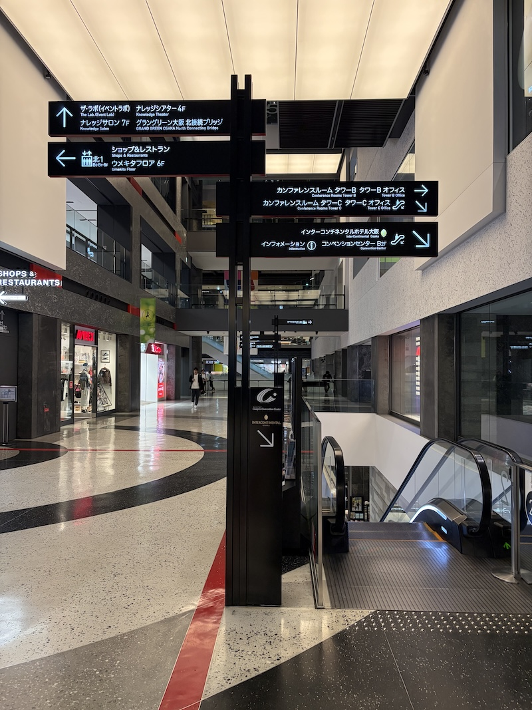
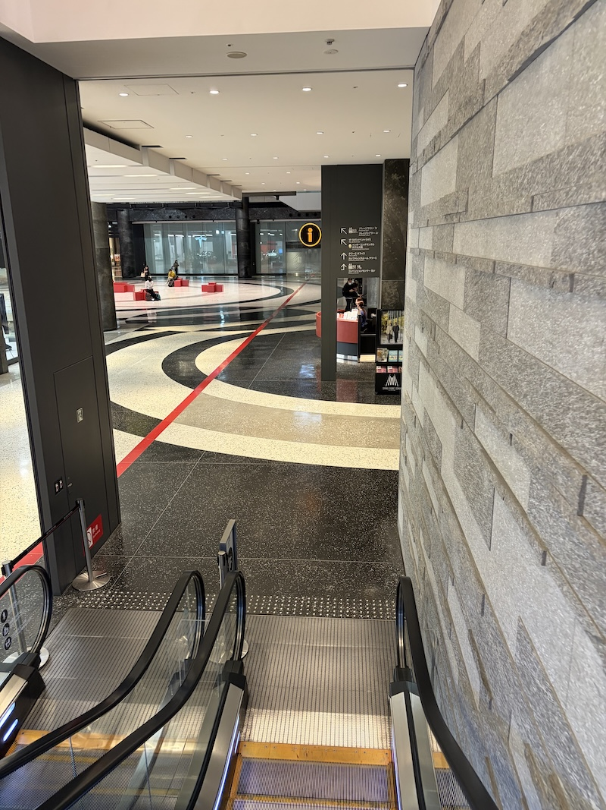
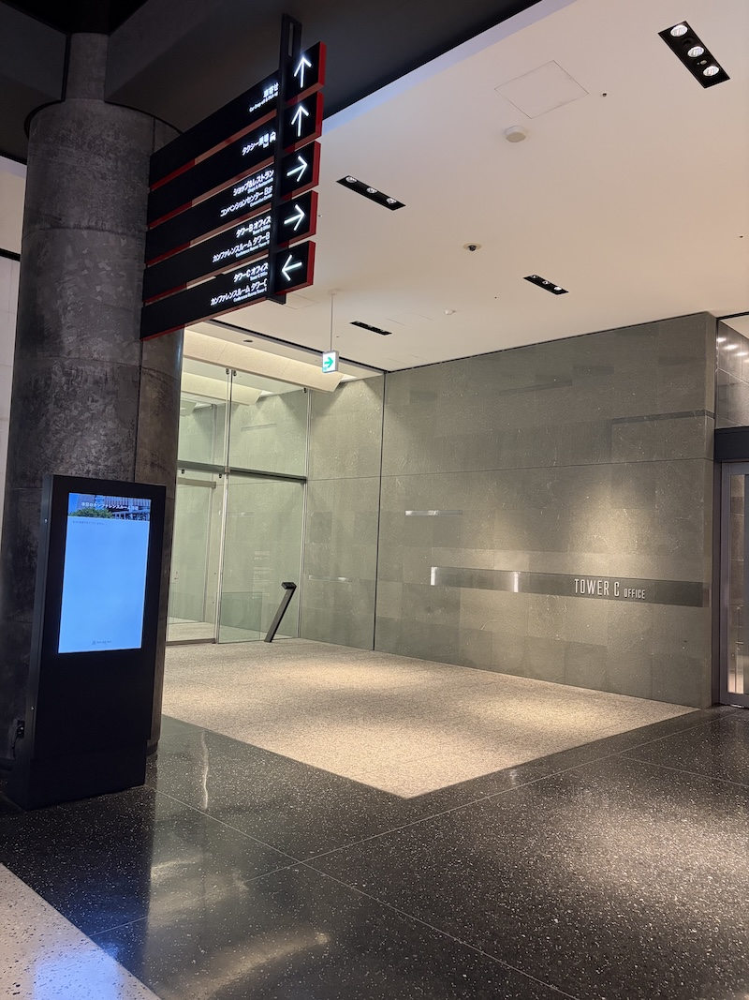
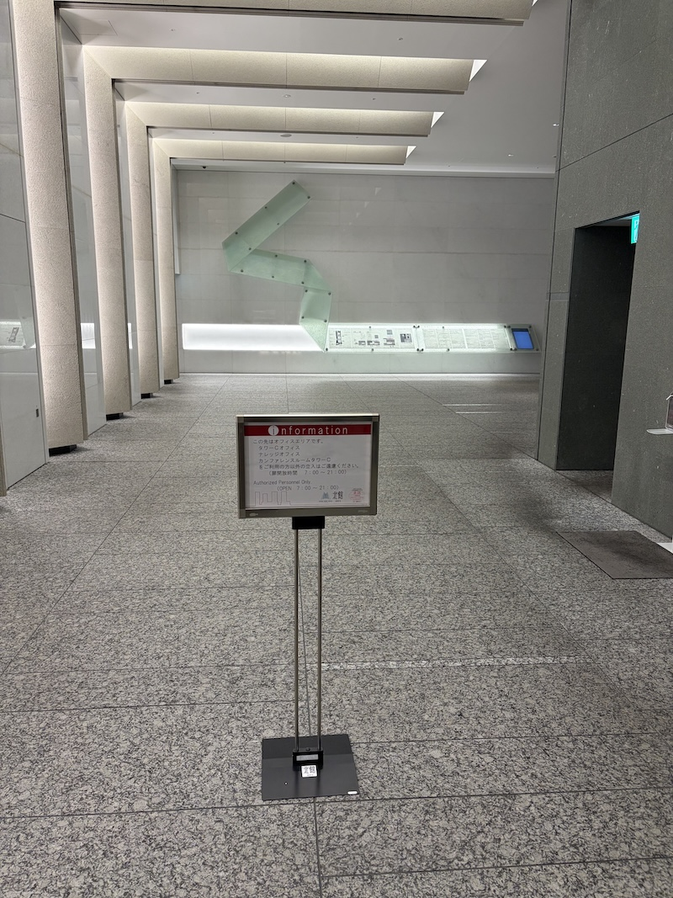
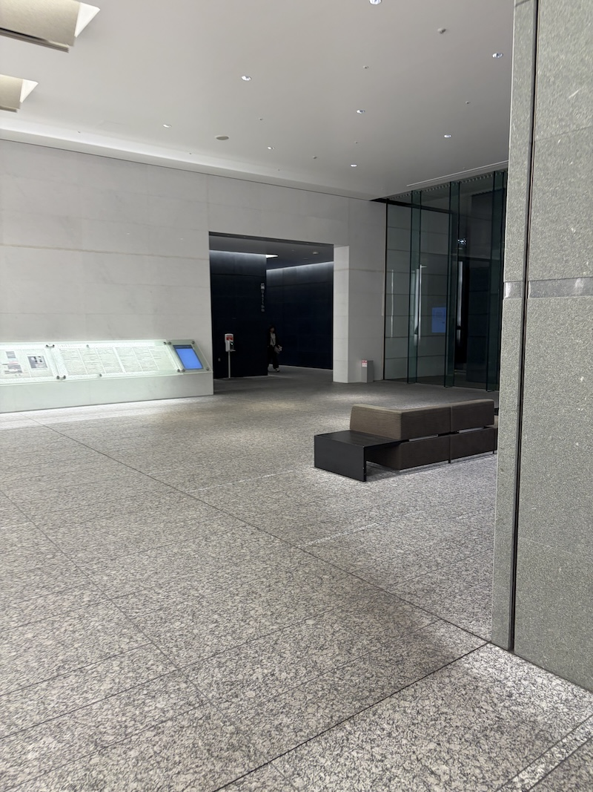
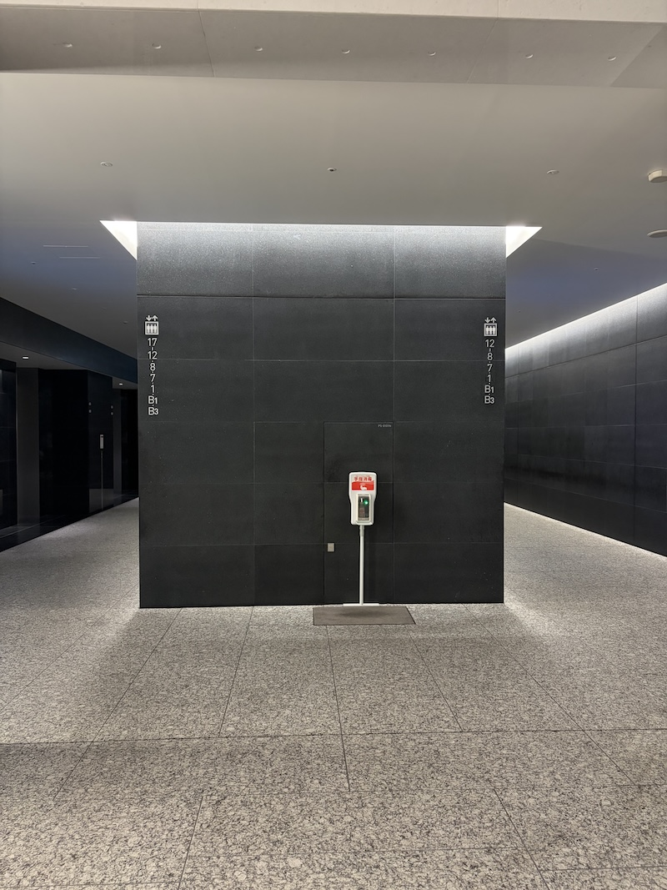
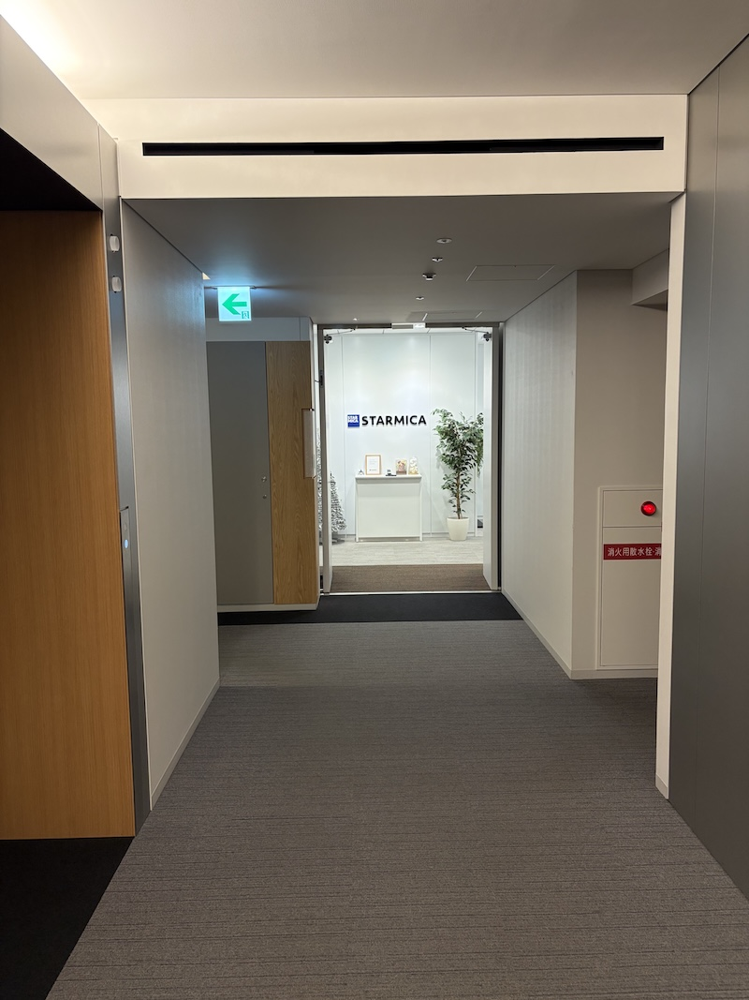

# gusuku Ashibinaa OSAKAへの行き方

## 大阪駅方面からのルート

大阪方面からグランフロントの南館2Fから北館へ進んでください。右手にエスカレーターが見えるのでくだります。

エスカレーターをくだってまっすぐ進みます。

突き当たりまでいくと、タワーCの入り口が見えます。

入り口には「関係者以外入るな」と書いてありますが、ここを入っていきます。

右手にエレベーターホールが見えます。

左右にエレベーターがありますが、16Fまで行けるのは左のエスカレーターのみです。

16Fで降りるとSTARMICAという会社のオフィスの入り口が見えるので、こちら方向に向かって左へ進み突き当たりの右のドアがgusuku Ashibinaa OSAKAです。

## アールスリーインスティテュートさんが掲載している地図へのリンク

[PDFはこちら](https://assets.r3it.com/gusuku_ashibinaa_osaka/gusukuAshibinaaOSAKA_Access.pdf?_gl=1*1qlva0l*_gcl_au*MzY1MDQzODI2LjE3ODg1NjIwMDY.*_ga*MTU0Njk4MTg2My4xNzg4NTYyMDA2*_ga_0703L2JJFB*czE3OTIzMjY3MzkkbzgkZzAkdDE3OTIzMjY3MzkkajYwJGwwJGgw)

スマートフォンでも見やすいように画像にしておきました。

